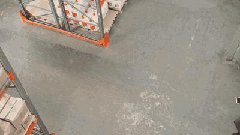
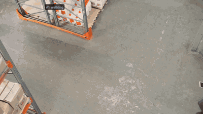
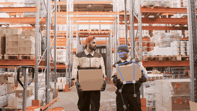
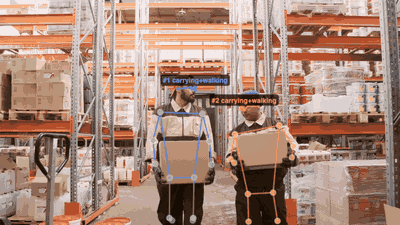
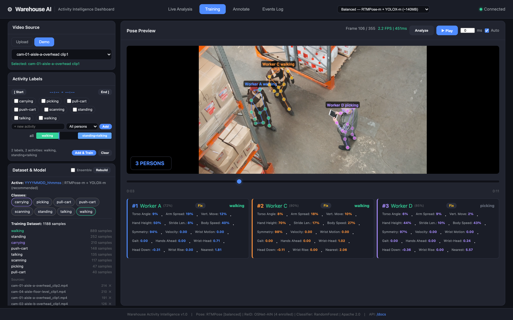

[English](README.md) | **Українська**

# Warehouse Activity Intelligence

**Чи може ноутбук зрозуміти, що роблять працівники складу, зі звичайного відео з камер, без GPU і без хмари?**

Оцінка пози → невеликий класифікатор активностей → реідентифікація працівників. Зібрано двічі (MediaPipe і RTMPose) і виміряно на відкладених кліпах.

## Передісторія

Усе почалося на хакатоні Nova Poshta × DEV Challenge (березень 2026), де невелика команда зробила прототип аналізу активності на поштовому терміналі. Правила хакатону не дозволяють публікувати той код і відео, тому цей репозиторій є незалежною реалізацією з нуля. Тут інші архітектурні рішення, щоб спробувати інші підходи до розпізнавання рухів і дій людини. Репозиторій не містить коду, даних чи відео з хакатонної роботи і не пов'язаний із Nova Poshta чи DEV Challenge.

## Що працює, а що ні

| | Статус | Чому |
|---|---|---|
| Скелети кількох людей у кадрі | ✅ RTMPose: 57–100% кадрів, більшість ракурсів | детектор top-down + поза для кожної людини |
| Цикл розмітка → тренування → live у браузері | ✅ обидва застосунки | мітки інтервалів (RTMPose) або мітка на весь кліп (MediaPipe) |
| Розпізнавання активностей на кліпі, якого модель не бачила | ❌ macro F1 0.24 | замало кліпів на активність; лише 2D-пози |
| Розпізнавання працівника з нового ракурсу камери | ❌ 0 зі 134 детекцій | ReID на вагах ImageNet; кожен кадр зіставляється окремо |
| Реальний час на CPU | ⚠️ MediaPipe 11–21 мс/кадр, RTMPose ~300–415 мс | RTMPose рахує позу та ReID для кожної людини |

## Результати на демо-даних

Це єдина сторінка з демо-даними; застосунки та інші документи працюють із будь-яким відео, яке ви покладете в `data/demo/`.

**Кліпи.** Реалістичне відео з камер спостереження, яке можна публікувати, знайти важко, тому для демо взяті найближчі стокові кліпи: дев'ять відео з [Pexels](https://www.pexels.com/license/), перейменованих як шість стаціонарних складських камер. Це постановочні зйомки, а не відеоспостереження; розташування камер змодельоване. Сім кліпів показують тих самих чотирьох працівників згори та на рівні очей. Самих кліпів у репозиторії немає; GIF і скріншоти є зміненими похідними. Працівники підписані нейтрально (`Worker A`–`D`).

| Камера | Кліп Pexels | Ракурс | Зміст |
|---|---|---|---|
| cam-01 (3 кліпи) | [4284181](https://www.pexels.com/video/4284181/), [4280746](https://www.pexels.com/video/4280746/), [4280748](https://www.pexels.com/video/4280748/) | згори | команда ходить, зупиняється, розмовляє |
| cam-02 | [4281405](https://www.pexels.com/video/4281405/) | згори | троє йдуть разом |
| cam-03 | [4284182](https://www.pexels.com/video/4284182/) | майже вертикально згори | рокла, відбір товару |
| cam-04 (2 кліпи) | [4293960](https://www.pexels.com/video/4293960/), [4292902](https://www.pexels.com/video/4292902/) | рівень очей | перенесення коробок; сканування |
| cam-05 | [6170059](https://www.pexels.com/video/6170059/) | згори, надворі | інша людина, ручний візок |
| cam-06 | [13422071](https://www.pexels.com/video/13422071/) | збоку, переважно ноги | інша людина, поломийна машина |

**Ті самі кліпи, ті самі кадри.** Кадри, де движок нікого не знайшов, залишені.

| | MediaPipe (lite) | RTMPose (balanced) |
|---|---|---|
| cam-01, згори |  |  |
| cam-04, рівень очей |  |  |

Працівників зареєстрували з cam-01, тому імена є там і відсутні на рівні очей. Мітки активностей у GIF дає модель, яка бачила ці кліпи під час тренування: вони показують пайплайн, а не точність.

### Детекція пози (кожен 5-й кадр, CPU, Apple silicon)

Колонки MediaPipe і RTMPose показують частку кадрів, де знайдено хоча б одну людину. У деяких кліпах люди виходять з кадру, тому порівнюйте движки між собою, а не зі 100%. Середня кількість людей рахується лише по кадрах, де когось знайдено.

| Кліп | Ракурс | MediaPipe | RTMPose | RTMPose, людей у середньому (макс.) |
|---|---|---|---|---|
| cam-01 #1 / #2 / #3 | згори | 77% / **7%** / 63% | 98% / 80% / 88% | 2.7 (3) / 2.6 (3) / 1.5 (3) |
| cam-02 | згори | 53% | 77% | 2.6 (3) |
| cam-03 | майже вертикально | **16%** | 92% | 1.8 (3) |
| cam-04 #1 / #2 | рівень очей | 81% / 66% | 91% / 87% | 2.0 (3) / 1.0 (2) |
| cam-05 | надворі | 54% | 100% | 1.0 (2) |
| cam-06 | збоку | 35% | 57% | 1.4 (**4**, насправді щонайбільше 2) |

MediaPipe за задумом повертає одну людину на кадр і втрачає людей, знятих згори. RTMPose теж помиляється: на cam-06 він бачить чотирьох людей там, де їх щонайбільше двоє.

### Класифікація активностей (leave-one-clip-out)

Тренуємо на всіх кліпах, крім одного, тестуємо на ньому, повторюємо для кожного кліпу. Синтетичних даних немає в жодному застосунку.

| | RTMPose: 9 кліпів, мітки інтервалів, 15 ознак | MediaPipe: 7 кліпів, мітка на кліп, 7 ознак |
|---|---|---|
| Випадковий поділ кадрів 80/20 (**некоректний**: сусідні кадри протікають) | 0.94 | 0.77 |
| Leave-one-clip-out, macro F1 | **0.24** | **0.17** |
| F1 для `walking` | 0.72 (не працює, коли люди йдуть на камеру) | 0.34 |
| `standing`, `push-cart` | 0.00 | — / 0.00 |
| не перевіряється (лише в одному кліпі) | carrying, picking, pull-cart, scanning, talking | carrying, scanning |

Ознаки руху (8 значень за 1.2 с для кожної відстежуваної людини) тут не допомогли: `walking` дав 0.72 з ними і 0.76 без них. Вузьке місце в кількості кліпів на активність, а не в моделі.

### Реідентифікація працівників

Галерея: 4 працівники, 8 кропів, усі з cam-01.

| Тест | Результат |
|---|---|
| Інші кліпи згори | імена призначаються, але у 8–12 кадрах на кліп одне ім'я отримують двоє людей |
| Рівень очей (cam-04), ті самі працівники | розпізнано **0 зі 134** і 0 з 81 детекцій (одне хибне ім'я) |
| Сторонні люди (cam-05, cam-06) | 7 зі 140 хибно названі |

Сирі дані: [benchmark-cameras.json](docs/benchmark-cameras.json), [eval-leave-one-clip-out.json](docs/eval-leave-one-clip-out.json), [reid-cross-camera.json](docs/reid-cross-camera.json). Числа детекції пози відтворюються скриптом [bench.py](.claude/skills/run-warehouse-dashboards/bench.py) на запущеному застосунку (`python3 .claude/skills/run-warehouse-dashboards/bench.py --app rtmpose --every 5 --video <кліп>`), F1 — скриптом leave-one-clip-out, описаним у README RTMPose.

## Дві реалізації

| | [Feature-RTMPose](Feature-RTMPose/) (рекомендовано) | [Feature-MediaPipe](Feature-MediaPipe/) |
|---|---|---|
| Модель пози | RTMPose + YOLOX, 17 ключових точок COCO | MediaPipe PoseLandmarker, 33 точки |
| Людей у кадрі | усі | одна |
| Вхід класифікатора | 7 ознак пози + 8 ознак руху, кілька міток одночасно | 7 ознак пози, одна мітка |
| Мітки для тренування | часові інтервали для кожної людини, проєкти | одна мітка на завантажений кліп |
| ReID працівників | OSNet-AIN, колекції працівників на проєкт | — |
| Порт | 8001 | 8000 |

Обидва мають ті самі чотири вкладки: **Live Analysis**, **Training**, **Annotate** (виправлення ключових точок і експорт у COCO) та **Events Log**.



## Швидкий старт

Python 3.10–3.12, macOS або Linux. Перший запуск створює venv і завантажує моделі пози. Кожен застосунок запускайте з його власної папки:

```bash
cd Feature-RTMPose && bash run.sh      # http://localhost:8001
```

```bash
cd Feature-MediaPipe && bash run.sh    # http://localhost:8000
```

Покладіть H.264 MP4 кліпи в `data/demo/` будь-якого з застосунків або завантажте їх у вкладці Training. Налаштування, тренування та API описані в README кожного застосунку (англійською).

## Документація

Усі документи англійською.

- [How activity recognition works](docs/how-activity-recognition-works.md): ознаки, 2D проти 3D, чесна оцінка
- [Objects and context](docs/objects-and-context.md): телефони, візки, сканери і те, чого скелет не бачить
- [Cross-camera ReID](docs/cross-camera-reid.md): як працівники зіставляються між камерами і чому це не працює
- [Design decisions](docs/design-decisions.md): чому RTMPose, а не MediaPipe чи YOLO

## Ліцензії

Код: [MIT](LICENSE). Моделі: MediaPipe, RTMPose і YOLOX під Apache 2.0, OSNet-AIN під MIT. Моделі пози завантажуються при першому запуску, OSNet-AIN експортується вручну (див. README RTMPose); жодна не входить до репозиторію. scikit-learn під BSD. YOLO11-Pose не використано через AGPL-3.0. Демо-кліпи: [Pexels License](https://www.pexels.com/license/), використані лише для похідних у `docs/`.
